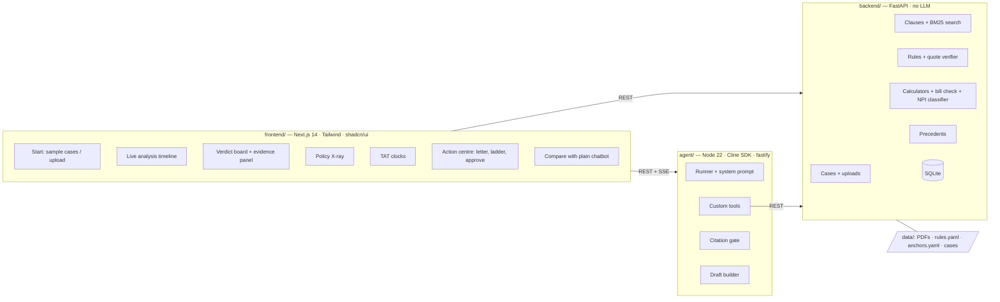
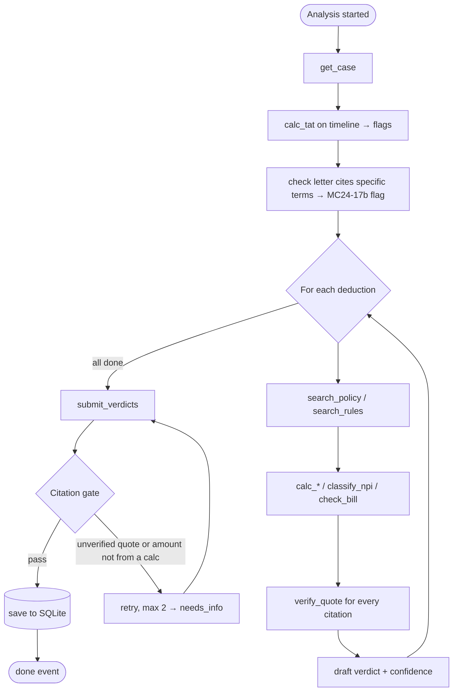
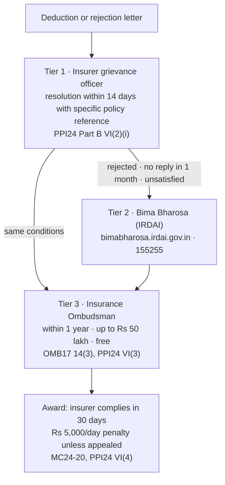

# Architecture — Health-insurance claim contest agent

One architecture, merged from two proposals: **A** (planning branch: rule base, sample cases, Node agent service) and **B** (`kaustav` branch). Source of truth for interfaces: `memory-bank/systemPatterns.md`.

## What was kept from each proposal

| Decision | Taken from | Why |
|---|---|---|
| Agent runs in a separate **Node 22 service** (Cline SDK), backend is FastAPI with **no LLM calls** | A | `@cline/sdk` is a Node package; it cannot be imported from Python (`llm_client.py` in `backend/` would not run) |
| Verified **rule base** (`data/rules/rules.yaml`, 27 verbatim rules with page numbers) + **BM25** search over clauses | A | Corpus is small (a few PDFs); a vector DB with sentence-transformers adds a multi-GB install and embedding drift for no gain in 8 hours |
| **Synthetic sample cases** A–E with computed expected verdicts; **scripted agent mode** so the UI works before the LLM agent | A | Demo cannot depend on live uploads or OCR working |
| **SSE live timeline** of agent steps | A | Shows the agent working; strongest demo moment |
| **SQLite persistence** of cases, analyses, verdicts, drafts, timeline | B | Survives refresh; enables case tracker and the approval gate |
| **Confidence score** per verdict; grievance drafted only for contestable verdicts with confidence ≥ 0.75 | B | Avoids drafting weak grievances |
| **Human approval gate** (`human_approved`) before Tier 2/3 drafts are shown | B | Safety: agent drafts, human files |
| **Three-tier ladder**: Tier 1 insurer GRO (14 days) → Tier 2 Bima Bharosa → Tier 3 Ombudsman (within one year, up to Rs 50 lakh, free) | B, corrected | PPI24 Part B VI(2)–(3) and OMB17 Rule 14(3) |
| **Non-payable item classifier** and **bill arithmetic check** (`amount_verifier`) as deterministic tools | B | Catches subsumed items and hospital arithmetic errors; lists come from the policy's own annexure because the 2020 IRDAI lists were repealed (MC24 Annexure-6) |
| **Evaluation harness** on published Ombudsman awards (outcome hidden) and an **award replay** demo mode | B | Measurable claim for judges: agreement with real Ombudsman decisions |
| Uploads with `pdfplumber`; OCR | B | Kept as **stretch** (TASK-16); text PDFs only, no system OCR binary |

## 1. System



## 2. Agent flow (per case)



Code vs model: **code** does text extraction, search, quote verification, every rupee and date, TAT, deadlines, non-payable classification, bill arithmetic. **Model** interprets labels, picks clauses, sets status and confidence, explains, drafts narrative paragraphs.

## 3. Data model

```mermaid
erDiagram
  CASE ||--o{ DOCUMENT : has
  CASE ||--o{ ANALYSIS : has
  ANALYSIS ||--o{ VERDICT : has
  ANALYSIS ||--o{ FLAG : has
  ANALYSIS ||--o{ DRAFT : has
  CASE ||--o{ LADDER_STEP : has
  CASE { string case_id PK; string source "sample|upload"; json payload }
  DOCUMENT { string doc_id PK; string case_id FK; string kind "settlement|bill|policy|discharge"; text raw_text }
  ANALYSIS { string analysis_id PK; string case_id FK; string status; float total_recoverable }
  VERDICT { string deduction_id; string status "valid|contestable|needs_info"; float recoverable_amount; float confidence; json citations; json calculation }
  FLAG { string kind "tat_breach|letter_not_specific|regulation_override"; string rule_id }
  DRAFT { int tier "1|2|3"; string language; text letter_markdown; bool human_approved }
  LADDER_STEP { int tier; date earliest; date latest; string rule_id; bool completed }
```

## 4. Escalation ladder



## 5. UI

Light, calm, fintech feel. Inter font; slate neutrals; status colours emerald (valid), amber (contestable), sky (needs info), rose (breach). Money in large tabular numerals, Indian grouping (₹1,10,000). Every quote shows a ✓ "verified against source, page N" chip.

| Screen | Layout |
|---|---|
| Start | Hero line, five sample-case cards (title, insurer, amount deducted), "Upload your documents" (stretch), "Replay an Ombudsman case" |
| Analysis | Left: live timeline (animated steps, tool chips). Right: source viewer with the clause being read highlighted |
| Verdict board | Summary card (recoverable of deducted, confidence), flags strip (TAT breach, vague letter, regulation override), deduction table with status chips; row → slide-over evidence panel (bill lines, policy quote, rule quote, calculation steps, similar Ombudsman cases with year) |
| Policy X-ray | Cards: room-rent cap, waiting periods with countdown, moratorium progress bar, "Regulation overrides this" badges |
| Clocks | Two horizontal timelines (cashless 1 h, discharge 3 h) with limit marker and breach label + amount the insurer bears |
| Action centre | Tier stepper (1 → 2 → 3) with dates, letter editor + preview, local-language summary, approve toggle (unlocks Tier 2/3), download .md/.pdf, add deadlines to calendar (.ics) |
| Compare | Two columns: plain chatbot answer vs our verdicts; chatbot errors highlighted inline |

## 6. Repository layout

```
backend/   app/{main.py, settings.py, db.py, text.py, models/, routes/, services/}  tests/
agent/     src/{server.ts, settings.ts, store.ts, scripted.ts, backend.ts, gate.ts, runner.ts, draft.ts, llm/}  test/
frontend/  app/, components/, lib/{api.ts, format.ts, ics.ts}, tests/
data/      PDFs, rules/rules.yaml, policies/anchors.yaml, cases/, baseline/, eval/
```
